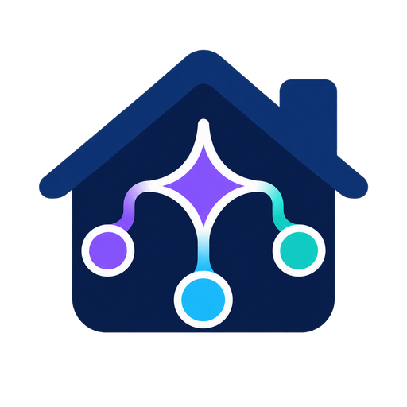

<p align="center">
  
</p>

# Home Assistant MCP Server & AI Control Service

A comprehensive solution for controlling Home Assistant with AI, featuring:
- **MCP Server**: Model Context Protocol server for Home Assistant integration
- **Spring Boot Service**: Web service with REST API, Vaadin Flow UI, and Spring AI + Ollama integration

## Project Structure

```
homeassistant-mcp/
├── mcp-server/          # Java MCP server for Home Assistant
│   └── src/main/java/com/homeassistant/mcp/
│       ├── HomeAssistantMcpServer.java
│       └── HomeAssistantClient.java
│
└── spring-service/      # Spring Boot web service
    └── src/main/java/com/homeassistant/ai/
        ├── client/      # Home Assistant REST client
        ├── config/      # Configuration classes
        ├── controller/  # REST API controllers
        ├── service/     # AI chat service
        └── view/        # Vaadin Flow UI
```

## Features

### MCP Server
- Standard MCP protocol implementation
- Tools for Home Assistant operations:
  - `get_states` - Get all entity states
  - `get_state` - Get specific entity state
  - `call_service` - Execute Home Assistant services
  - `get_services` - List available services
  - `get_config` - Get Home Assistant configuration

### Spring Boot Service
- **REST API**: Full Home Assistant control via HTTP endpoints
- **Vaadin Flow UI**: Interactive web interface with:
  - AI chat assistant powered by Ollama
  - Real-time device listing and control
  - Turn on/off lights, switches, fans, etc.
- **Spring AI Integration**: Chat with AI about your home and control devices

## Prerequisites

- Java 21 (Amazon Corretto 23 JDK)
- Maven 3.8+
- Home Assistant instance running at `http://homeassistant.local:8123`
- Ollama running locally at `http://localhost:11434`
- Ollama model installed (e.g., `ollama pull llama3.2`)

## Configuration

### Home Assistant Access Token
The projects are pre-configured with your Home Assistant access token. To change it:

**MCP Server**: Edit `mcp-server/src/main/java/com/homeassistant/mcp/HomeAssistantMcpServer.java` or set environment variable:
```bash
export HA_ACCESS_TOKEN="your-token-here"
export HA_BASE_URL="http://homeassistant.local:8123"
```

**Spring Service**: Edit `spring-service/src/main/resources/application.properties`:
```properties
homeassistant.base-url=http://homeassistant.local:8123
homeassistant.access-token=your-token-here
```

### Ollama Configuration
Configure Ollama settings in `spring-service/src/main/resources/application.properties`:
```properties
spring.ai.ollama.base-url=http://localhost:11434
spring.ai.ollama.chat.options.model=llama3.2
spring.ai.ollama.chat.options.temperature=0.7
```

## Building & Running

### MCP Server

Build:
```bash
cd mcp-server
mvn clean package
```

Run:
```bash
java -jar target/homeassistant-mcp-server-1.0.0.jar
```

The MCP server communicates via stdin/stdout following the MCP protocol.

### Spring Boot Service

Build:
```bash
cd spring-service
mvn clean package
```

Run:
```bash
mvn spring-boot:run
```

Or run the JAR:
```bash
java -jar target/homeassistant-ai-service-1.0.0.jar
```

Access the application:
- **Web UI**: http://localhost:8080
- **REST API**: http://localhost:8080/api/

## REST API Endpoints

### Home Assistant Control
- `GET /api/homeassistant/states` - Get all entity states
- `GET /api/homeassistant/states/{entityId}` - Get specific entity state
- `POST /api/homeassistant/services/{domain}/{service}` - Call a service
- `GET /api/homeassistant/services` - List all services
- `GET /api/homeassistant/config` - Get configuration

### AI Chat
- `POST /api/chat` - Send a message to the AI
  ```json
  {
    "message": "Turn on the living room lights"
  }
  ```
- `POST /api/chat/clear` - Clear conversation history

## Usage Examples

### Using the Web UI
1. Navigate to http://localhost:8080
2. Chat with the AI assistant about your home
3. Control devices directly with the on/off buttons
4. Ask questions like:
   - "What lights are currently on?"
   - "Turn off all the lights in the bedroom"
   - "What's the temperature?"

### Using the REST API

Get all states:
```bash
curl http://localhost:8080/api/homeassistant/states
```

Turn on a light:
```bash
curl -X POST http://localhost:8080/api/homeassistant/services/light/turn_on \
  -H "Content-Type: application/json" \
  -d '{"entity_id": "light.living_room"}'
```

Chat with AI:
```bash
curl -X POST http://localhost:8080/api/chat \
  -H "Content-Type: application/json" \
  -d '{"message": "What devices are on right now?"}'
```

### Using the MCP Server
The MCP server follows the Model Context Protocol. Example initialization:
```json
{
  "jsonrpc": "2.0",
  "id": 1,
  "method": "initialize",
  "params": {
    "protocolVersion": "2024-11-05",
    "capabilities": {}
  }
}
```

## Development

### Adding New Features
- **MCP Server**: Add new tools in `HomeAssistantMcpServer.handleToolsList()`
- **REST API**: Create new controllers in `spring-service/src/main/java/com/homeassistant/ai/controller/`
- **UI**: Modify `MainView.java` or add new Vaadin views

### Testing
Test Home Assistant connection:
```bash
curl -H "Authorization: Bearer YOUR_TOKEN" \
  http://homeassistant.local:8123/api/states
```

Test Ollama:
```bash
curl http://localhost:11434/api/generate -d '{
  "model": "llama3.2",
  "prompt": "Hello, world!"
}'
```

## Troubleshooting

**Cannot connect to Home Assistant:**
- Verify Home Assistant is running
- Check the URL and access token
- Ensure the token has the necessary permissions

**Cannot connect to Ollama:**
- Start Ollama: `ollama serve`
- Verify the model is installed: `ollama list`
- Pull the model if needed: `ollama pull llama3.2`

**Vaadin compilation issues:**
- Run `mvn vaadin:prepare-frontend`
- Clear npm cache if needed: `rm -rf node_modules`

## License

MIT License - feel free to modify and use as needed.

## Contributing

Contributions are welcome! Feel free to submit issues or pull requests.
